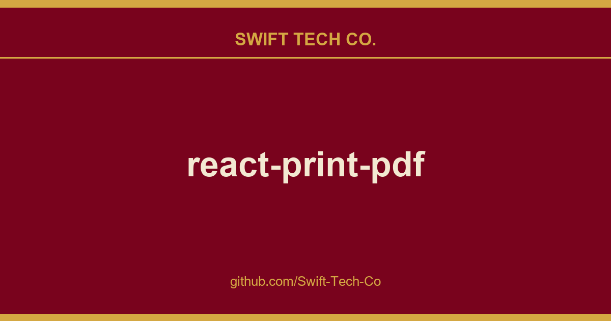

# react-print-pdf

## What This Is

This is part of the Swift Tech Co. working stack for product and engineering. It gathers the react-print-pdf notes, examples and fixes that keep delivery fast, and doubles as the reference map we hand to whoever picks up this thread next.

## Images

[](https://github.com/Swift-Tech-Co/react-print-pdf)

## 1. Installation 💿

Get the _react-print_ component library.

### With npm

```sh npm
npm install @fileforge/react-print
```

### With yarn

```sh yarn
yarn add @fileforge/react-print
```

### With pnpm

```sh pnpm
pnpm add @fileforge/react-print
```

## 2. Import component ↪️

Import the components you need to your PDF template from our list of pre-build components :

```javascript
import { PageTop, PageBottom, PageBreak } from "@fileforge/react-print";
```

## 3. Integrate in your document 📄

Integrate your components and include styles where needed.

```javascript
export const Document = ({ props }) => {
  return (
    <div>
      <PageTop>
        <span>Hello #1</span>
      </PageTop>
      <div>Hello #2</div>
      <PageBottom>
        <div className="text-gray-400 text-sm">Hello #3</div>
      </PageBottom>
      <PageBreak />
      <span>Hello #4, but on a new page ! </span>
    </div>
  );
};
```

## 4. Generate HTML 💻

```javascript
import { compile } from "@fileforge/react-print";

const html = await compile(<Document />);
```

# Components 🗂️

A set of standard components to help you build amazing documents without having to deal with the mess of creating complex layouts and maintaining archaic markup. Help us extend this list by actively contributing and adding your favorite components!

Browse all currently supported components →

> [!NOTE]
> Help us extend this list by actively contributing and adding your favorite components!

# Integrations 🔗

PDF designed with _react-print-print_ can be generated, hosted (and more) with your preferred document management providers.

- Fileforge : HTML to PDF, cloud hosting, analytics and more.

# Contributing 🫂

Wanna help ? Awesome! There are many ways you can contribute! Take a look at:

- Contributing Guide

# Authors 🧑‍💻

# License 📜

License

# Join the movement ! 🚀

## Activity

[](https://github.com/Swift-Tech-Co/react-print-pdf)

## Contributors ✨

<a href="https://github.com/Swift-Tech-Co/react-print-pdf">
  
</a>

## Star History 🌟

<a href="https://github.com/Swift-Tech-Co/react-print-pdf">
  <picture>
    <source media="(prefers-color-scheme: dark)" srcset="https://github.com/Swift-Tech-Co/react-print-pdf" />
    <source media="(prefers-color-scheme: light)" srcset="https://github.com/Swift-Tech-Co/react-print-pdf" />
    
  </picture>
</a>

<div class="title-block" style="text-align: center;" align="center">

[](https://github.com/Swift-Tech-Co/react-print-pdf)
[](https://t.me/+Qt_eFvkb2rliMzNh)
[](https://github.com/Swift-Tech-Co/react-print-pdf)

</div>

---

---

## Swift Tech Co.

Built and maintained by Swift Tech Co.

AI Automation | FinTech Platforms | Custom Software and Mobile Apps | SaaS Platforms | Cloud Infrastructure | Cybersecurity | SEO and Marketing | API Integration

**Join our community on Telegram:** [t.me/+Qt_eFvkb2rliMzNh](https://t.me/+Qt_eFvkb2rliMzNh)

Home | Services | Careers | Referral Program | Influencers | About | Contact

**Connect**

- Website: https://github.com/Swift-Tech-Co/react-print-pdf
- LinkedIn: [linkedin.com/in/stephenoladoke](https://www.linkedin.com/in/stephenoladoke/)
- LinkedIn (Company): [linkedin.com/company/swift-tech-co](https://www.linkedin.com/company/swift-tech-co)
- X: [@MrOladoke](https://x.com/MrOladoke)
- Instagram: [@mr.oladoke](https://www.instagram.com/mr.oladoke/)
- Organization: [github.com/Swift-Tech-Co](https://github.com/Swift-Tech-Co)

## Sources

Compiled and maintained from upstream [OnedocLabs/react-print-pdf](https://github.com/OnedocLabs/react-print-pdf) under permissive open-source license.

---

Maintained by [Swift Tech Co.](https://github.com/Swift-Tech-Co) - [Telegram](https://t.me/+Qt_eFvkb2rliMzNh)

## Sources

Compiled and maintained from upstream [OnedocLabs/react-print-pdf](https://github.com/OnedocLabs/react-print-pdf) under permissive open-source license.

---

Maintained by [Swift Tech Co.](https://github.com/Swift-Tech-Co) - [Telegram](https://t.me/+Qt_eFvkb2rliMzNh)

## Sources

Compiled and maintained from upstream [OnedocLabs/react-print-pdf](https://github.com/OnedocLabs/react-print-pdf) under permissive open-source license.

---

Maintained by [Swift Tech Co.](https://github.com/Swift-Tech-Co) - [Telegram](https://t.me/+Qt_eFvkb2rliMzNh)